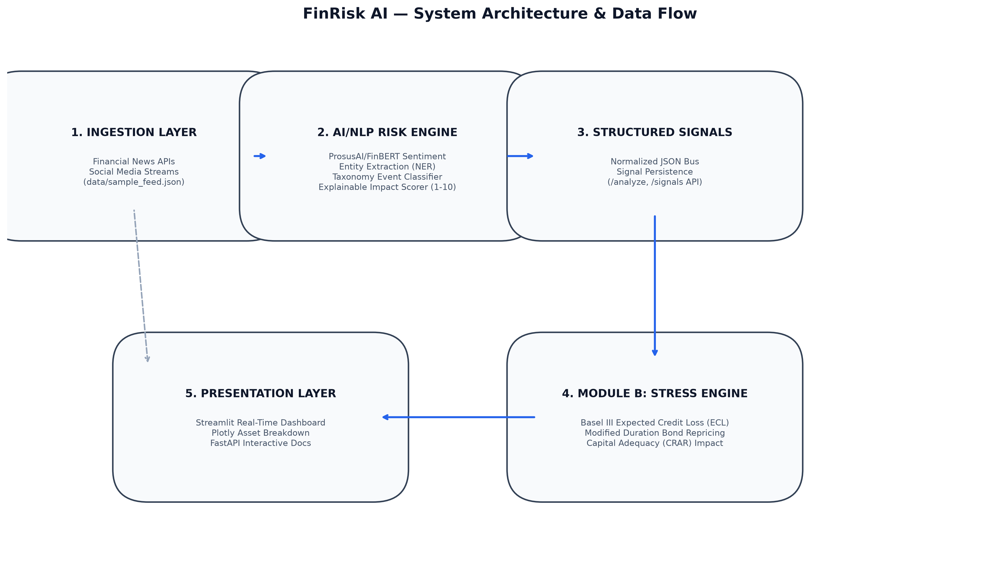

# FinRisk AI - S&P Global & Crisil Campus Hackathon 2026

**Candidate Name:** Harshita Singla
**College Email ID:** harshita065btcseai23@igdtuw.ac.in 
**College / Campus:** Indira Gandhi Delhi Technical University for Women
**Demo Video Link:** https://youtu.be/O7cUdiIWBcU
**Slide Deck Link (if hosted externally):** docs/presentation.pdf  

---

## 1. Project Overview / Problem Statement & Approach
Financial risk signals frequently appear in unstructured text—breaking news, earnings calls, and market commentary—long before they register in credit agency ratings or quarterly regulatory disclosures. 

**FinRisk AI** solves this latency gap by pairing a domain-adapted NLP Risk Engine with an automated wholesale portfolio stress-testing platform (Module B). The engine transforms raw unstructured text into structured, machine-readable risk vectors (Sentiment Score, Event Classification, and Impact Severity). When critical tail risks are detected, the system immediately propagates asset-specific macro and credit shocks across a ₹100 Lakh bank exposure book.

## 2. Architecture & Tech Stack


- **Language & Runtime:** Python 3.10+
- **NLP & Deep Learning:** Hugging Face Transformers (`ProsusAI/finbert`), PyTorch
- **Risk Simulation Engine:** Custom Duration-adjusted bond re-pricing and credit default impairment modeling
- **Backend API:** FastAPI, Pydantic, Uvicorn
- **Interactive UI:** Streamlit, Plotly Express & Graph Objects

## 3. Dataset Used
- **Financial News & Social Streams:** Structured sample feed containing normalized corporate credit downgrades, rate hikes, geopolitical embargoes, and earnings reports (`data/sample_feed.json`).
- **Wholesale Portfolio Book:** Synthetic ₹100 Lakh multi-asset banking portfolio comprising Corporate Loans, Sovereign G-Secs, Corporate Bonds, Equities, and Interest Rate Swaps (`data/synthetic_portfolio.csv`).
- *Note:* All datasets are strictly synthetic or derived from public financial taxonomies in full compliance with hackathon confidentiality guidelines.

## 4. Quickstart & Installation
Runtime: **Python 3.10+** (Tested on macOS / Linux / Windows)

```bash
# 1. Clone repository
git clone [https://github.com/](https://github.com/)<your-username>/TechnoIndiaNJR-RudraSingla-hackathon.git
cd TechnoIndiaNJR-RudraSingla-hackathon

# 2. Set up virtual environment
python3 -m venv venv
source venv/bin/activate  # On Windows: .\venv\Scripts\activate

# 3. Install dependencies
pip install -r requirements.txt

# 4. Launch the Interactive Dashboard
streamlit run src/app.py --server.fileWatcherType none